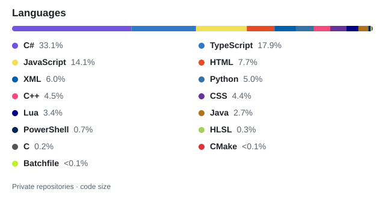

<!-- Append this block to your existing profile README.md. Keep your other content. -->
<picture>
  <source media="(prefers-color-scheme: dark)" srcset="./assets/private-languages-dark.svg">
  <source media="(prefers-color-scheme: light)" srcset="./assets/private-languages.svg">
  
</picture>
